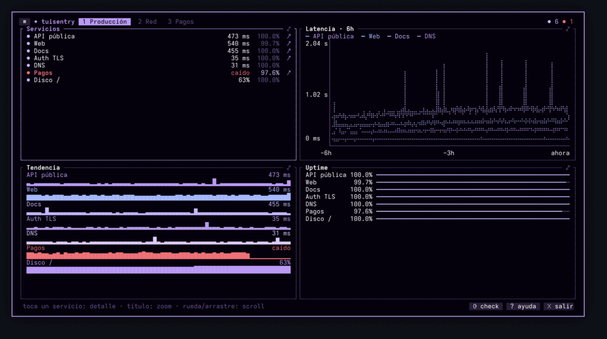
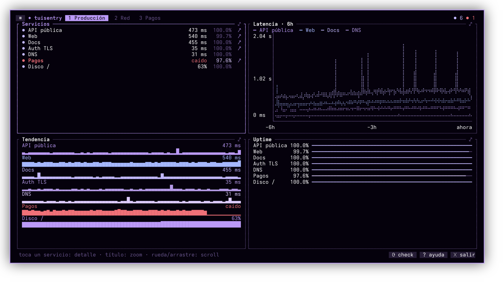
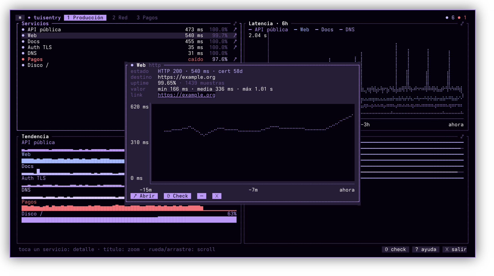
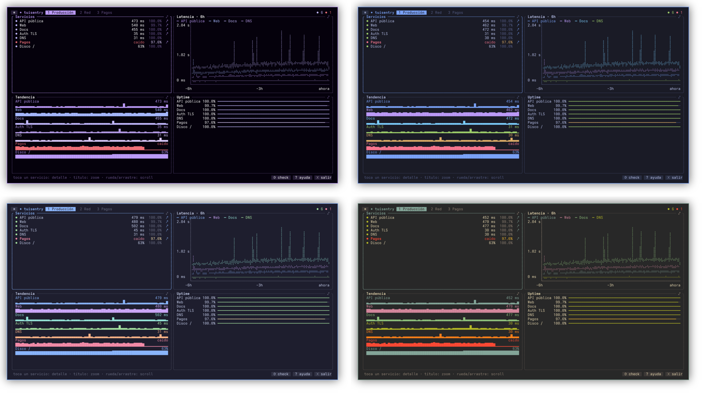
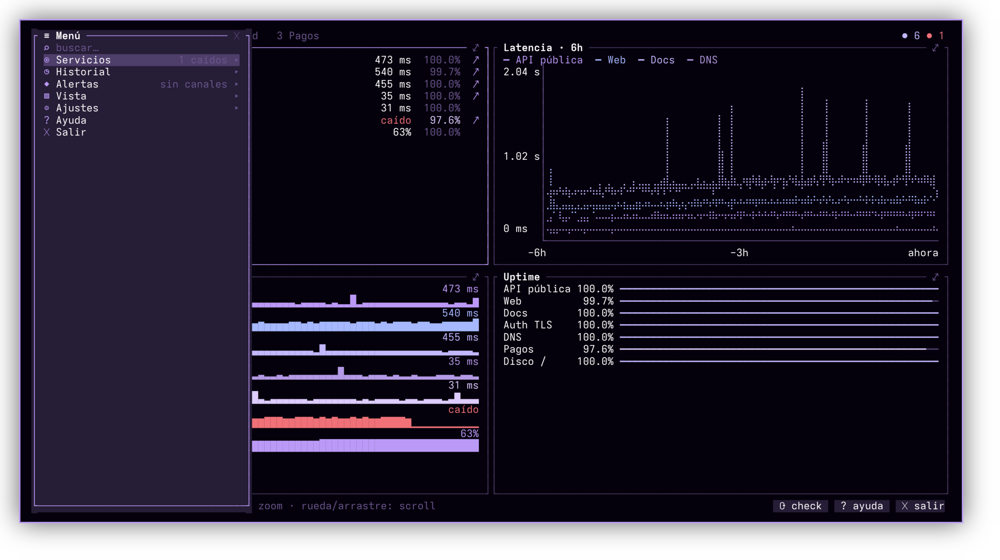
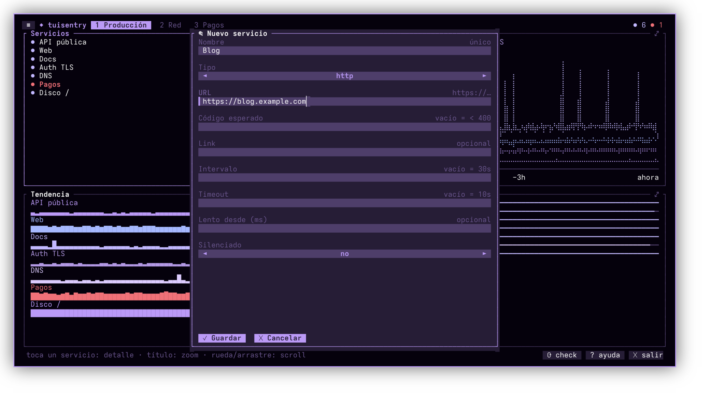
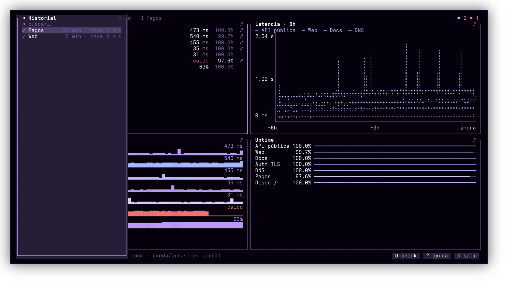
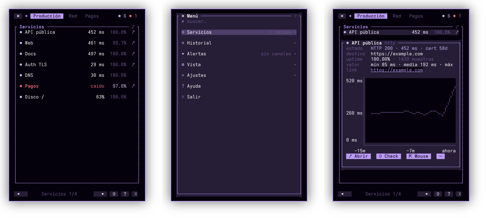

<div align="center">

# ◆ tuisentry

**Tu monitor de servicios, en la terminal.**<br>
Ligero, bonito y táctil: úsalo con el mouse en el escritorio o con el dedo desde el celular.

[](https://github.com/jorge07RD/tuisentry/actions/workflows/ci.yml)
[](LICENSE)
[](https://www.rust-lang.org)
[](https://omarchy.org)



</div>

<table>
<tr>
<td width="33%" valign="top">

**📈 Paneles de gráficas**<br>
Estado, latencia, tendencias y uptime en páginas que tú defines. Toca un servicio y ves su detalle.

</td>
<td width="33%" valign="top">

**🔔 Alertas al celular**<br>
Caídas, recuperaciones, lentitud y certificados por vencer, por escritorio o push con ntfy.

</td>
<td width="33%" valign="top">

**👆 Todo con el dedo**<br>
Cada botón es tocable. Sírvela con ttyd y úsala desde el navegador del cel.

</td>
</tr>
<tr>
<td valign="top">

**🕘 Historial que no se pierde**<br>
Gráficas que sobreviven reinicios, incidentes con duración, uptime de 30 días y exportar a CSV.

</td>
<td valign="top">

**✎ Se edita desde la app**<br>
Añade servicios, paneles y páginas con formularios; tu TOML conserva sus comentarios.

</td>
<td valign="top">

**🪶 Ligera de verdad**<br>
Binario de ~4 MB, ~4 MB de RAM y 0 % de CPU entre comprobaciones. Daemon opcional.

</td>
</tr>
</table>

Vigila endpoints **HTTP/HTTPS**, puertos **TCP**, **ping**, unidades **systemd** (locales
o por ssh) y cualquier métrica que saque un **comando**.

## Instalar

Requiere Rust 1.89 o más reciente.

```sh
cargo install --git https://github.com/jorge07RD/tuisentry
tuisentry --init          # crea ~/.config/tuisentry/config.toml de ejemplo
tuisentry                 # o: tuisentry --config otra.toml
tuisentry --once          # ejecuta cada check una vez y sale (útil en scripts/CI)
tuisentry --daemon        # sin interfaz: guarda historial y alerta
```

## Uso

| Toque / clic       | Hace                                      |
|--------------------|-------------------------------------------|
| `≡` arriba         | menú: servicios, vista, ajustes y búsqueda |
| un servicio        | abre el detalle: gráfica, stats y link    |
| `↗`                | abre el recurso monitoreado               |
| título de un panel | zoom a pantalla completa (otra vez: sale) |
| pestañas arriba    | cambia de página                          |
| `◄` `►` abajo      | panel anterior/siguiente (pantalla chica) |
| arrastrar / rueda  | desplaza la lista                         |
| `⟳` `?` `✕`        | re-check de todo · ayuda · salir          |

Teclado opcional: `Espacio`/`:` menú (escribe para buscar cualquier acción o
servicio), `Tab`/`1-9` páginas, `h`/`l` paneles, `j`/`k` scroll, `Enter` zoom,
`r` re-check, `o` abrir link, `m` mouse libre, `Esc`, `q`.

Con menos de 100 columnas se muestra un panel a la vez, pensado para el celular.



### Detalle de un servicio

Toca cualquier servicio: estado y certificado, uptime, latencia mínima/media/máxima,
su gráfica y botones para abrir el recurso, comprobar ahora o ir a sus opciones (`⋯`).



### Temas

Con `[theme] name = "omarchy"` (el valor por defecto si usas
[Omarchy](https://omarchy.org)), tuisentry toma la paleta del tema activo del
sistema (`~/.local/state/omarchy/current/theme/colors.toml`), con esquinas
rectas como el resto de Omarchy, y se repinta solo cuando cambias de tema con
`omarchy theme set`. También trae `tokyonight`, `catppuccin` y `gruvbox`, que se
eligen desde Ajustes → Tema.

<p align="center"></p>

### Menú

Tócalo en `≡` o abre con `Espacio`; escribe para buscar cualquier acción o servicio.

<p align="center"></p>

| Sección   | Qué tiene                                                              |
|-----------|------------------------------------------------------------------------|
| Servicios | añadir · comprobar todo · pausar/reanudar todo · por servicio: detalle, abrir, copiar URL, comprobar, pausar, silenciar, editar, borrar |
| Vista     | ventana de tiempo (5m–24h) · ordenar (config, nombre, estado, latencia) · solo caídos · filas táctiles · añadir/quitar paneles · nueva página |
| Historial | incidentes abiertos y cerrados con su duración                         |
| Alertas   | enviar prueba · canales configurados · silenciar por servicio           |
| Ajustes   | tema · recargar config · editar config en `$EDITOR`                      |

Cada servicio muestra además su uptime de 24h/7d/30d y se puede exportar a CSV
(`~/tuisentry-<servicio>-<fecha>.csv`).

### Editar desde la app

Servicios, paneles y páginas se pueden crear, editar y borrar desde el menú con
formularios táctiles; los campos se adaptan al tipo (un `http` pide URL, un
`systemd` pide unidad y host). Los cambios se escriben en tu `config.toml`
**conservando comentarios y orden**, y solo si el resultado es válido. Al
renombrar o borrar un servicio también se actualizan los paneles que lo usan.

<p align="center"></p>

### Alertas

Avisos de caída, recuperación (con duración), lentitud y certificado TLS por
vencer, por escritorio (`notify-send`) y/o push al celular con
[ntfy](https://ntfy.sh). Tocar el push abre el recurso.

```toml
[alerts]
fail_after = 2
slow_ms = 2000
cert_days = 14

[[alerts.notify]]
kind = "desktop"

[[alerts.notify]]
kind = "ntfy"
topic = "un-nombre-dificil-de-adivinar"
```

Desde el menú **Alertas** puedes enviar una prueba y silenciar servicios. Las
alertas se envían mientras tuisentry está abierto; para recibirlas siempre,
activa el modo daemon.

### Modo daemon (alertas 24/7)

Por defecto el monitoreo vive dentro de la TUI. Para que siga guardando historial
y alertando con la ventana cerrada, activa el daemon (servicio de usuario de
systemd):

```sh
tuisentry --install-daemon      # o desde el menú: Ajustes → Daemon
tuisentry --uninstall-daemon
```

Con el daemon corriendo, cada TUI que abras se conecta a él (`⇄ daemon` en la
cabecera) por `$XDG_RUNTIME_DIR/tuisentry.sock`: ves los mismos datos, y pausar,
silenciar o comprobar desde cualquier ventana actúa sobre el daemon. Sin daemon,
si abres dos TUIs, solo la primera guarda y alerta; la segunda queda en
`◌ solo vista`, para no duplicar avisos.

### Historial

Las muestras se guardan en `~/.local/state/tuisentry/history/<servicio>/<AAAA-MM>.jsonl`
(un JSON por línea, fácil de procesar con `jq`) y los incidentes cerrados en
`incidents.jsonl`. Un servicio cuenta como caído tras 2 fallos seguidos, para
no registrar parpadeos. La retención se ajusta con `[history] retention`.
Las preferencias (tema, vista, servicios pausados) viven en la misma carpeta;
`TUISENTRY_STATE_DIR` permite usar otra.

<p align="center"></p>

## Desde el celular (navegador)

La TUI corre en tu PC y la sirves con [ttyd](https://github.com/tsl0922/ttyd);
en el cel solo abres una URL. Los toques llegan como clics.

<p align="center"></p>

```sh
ttyd -W -p 7681 -t fontSize=15 -t disableLeaveAlert=true tuisentry --web
```

Ábrela desde el cel en `http://<ip-del-pc>:7681`. **No la expongas a internet
sin protección**: úsala dentro de Tailscale/WireGuard o añade `-c usuario:clave`
(y TLS con `--ssl`).

`--web` cambia tres cosas:

- Filas, pestañas y botones más altos para el dedo.
- `↗` no ejecuta `xdg-open` (abriría el navegador del PC): copia la URL
  (OSC 52) y la muestra.
- En el detalle aparece **⇱ Mouse libre**: suelta el mouse 10 s para que
  puedas tocar el link (es un hipervínculo OSC 8) o seleccionar texto.
  Cualquier tecla lo devuelve antes.

## Config

Mira [`config.example.toml`](config.example.toml). Lo esencial:

```toml
[[host]]
name = "vps"
ssh = "jorge@vps.example.com"   # login sin contraseña; se reutiliza la conexión

[[service]]
name = "Blog"
kind = "http"                   # http | tcp | ping | systemd | cmd
target = "https://blog.example.com"
interval = "30s"

[[service]]
name = "nginx"
kind = "systemd"
host = "vps"
unit = "nginx.service"
link = "https://vps.example.com:9090"   # p. ej. Cockpit

[[service]]
name = "RAM vps"
kind = "cmd"
host = "vps"
command = "free | awk '/Mem/ {printf \"%.0f\", $3/$2*100}'"
suffix = "%"

[[page]]
title = "VPS"
  [[page.panel]]
  kind = "status"               # status | chart | spark | gauge
  host = "vps"
  [[page.panel]]
  kind = "chart"
  services = ["Blog"]
  window = "1h"
```

`ping` usa ICMP sin root; si falla con permiso denegado, revisa
`sysctl net.ipv4.ping_group_range`.

## Extender

- **Nuevo tipo de check**: implementa `Check` (`src/checks/mod.rs`) en un módulo
  y añade su `kind` al `match` de `checks::build`.
- **Nuevo tipo de panel**: implementa `Panel` (`src/panels/mod.rs`) y añádelo a
  `panels::build`. Registra en el `HitMap` las áreas tocables con su `Action`.
- **Sin recompilar**: `kind = "cmd"` acepta cualquier comando cuyo stdout empiece
  por un número.

> Las capturas usan datos de demostración.

## Licencia

[MIT](LICENSE) © 2026 Jorge Isac Beriguete Mateo
